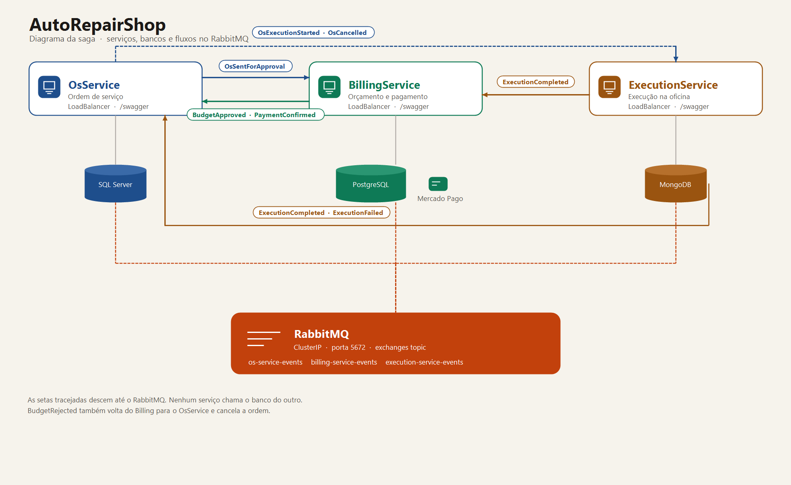

# AutoRepairShop — ExecutionService

Microsserviço responsável por **executar o serviço aprovado** na oficina.  
Parte da arquitetura distribuída do **Tech Challenge Fase 4 · 12SOAT**.

## Arquitetura



Os três serviços ficam no namespace `autorepair`. Cada API tem LoadBalancer e Swagger. O RabbitMQ continua `ClusterIP`: os pods publicam e consomem na porta 5672.

```
src/
├── ExecutionService.Api            → Controllers REST, Swagger, Program.cs
├── ExecutionService.Application    → App Services, DTOs, Event Handlers (Saga consumers)
├── ExecutionService.Domain         → Entidade Execution, Enums, Domain Events
└── ExecutionService.Infrastructure → MongoDB, RabbitMQ
tests/
└── ExecutionService.Tests
    └── Unit/                       → Testes unitários (xUnit + FluentAssertions + Moq)
k8s/                                → Deployment, Service, HPA, ConfigMap
.github/workflows/ci.yml            → CI/CD (Build → Testes → SonarQube → Docker → K8s)
```

## Banco de dados

**MongoDB 7** — documento simples e isolado: `OsId`, `Status`, `StartedAt`, `CompletedAt`, `Notes`.

## Fluxo de Status

```
InProgress → Completed
           ↘ Cancelled
```

A execução nasce ao consumir `OsExecutionStartedEvent`. Não há `POST` de criação.

## Saga Pattern — Coreografado

### Eventos publicados (RabbitMQ · exchange: `execution-service-events`)

| Evento | Quando | Consumidor |
|---|---|---|
| `ExecutionCompletedEvent` | Técnico conclui o serviço | BillingService (abre checkout), OsService (`Finish`) |

### Eventos consumidos (exchange: `os-service-events`)

| Evento | Origem | Ação |
|---|---|---|
| `OsExecutionStartedEvent` | OsService | Cria Execution em InProgress |
| `OsCancelledEvent` | OsService | Cancela a execução em andamento |

## Endpoints REST

| Método | Rota | Descrição |
|---|---|---|
| `GET` | `/api/execution/{id}` | Busca pelo id |
| `GET` | `/api/execution/os/{osId}` | Busca a execução da OS |
| `GET` | `/api/execution?status=InProgress` | Fila por status |
| `PATCH` | `/api/execution/os/{osId}/complete` | Conclui e publica `ExecutionCompletedEvent` |
| `PATCH` | `/api/execution/os/{osId}/notes` | Observação do técnico |
| `PATCH` | `/api/execution/os/{osId}/cancel` | Override de cancelamento |
| `GET` | `/health` | Health check |

Swagger: `http://localhost:5012/swagger`

## Executando com Docker

```bash
docker compose up -d
```

Sobe API (porta **5012**), MongoDB (**27017**) e RabbitMQ (**5672** / UI **15672**).

## Testes

```bash
dotnet test
dotnet test --collect:"XPlat Code Coverage"
```

Cobertura mínima exigida pelo pipeline: **80%** de linhas. Abaixo disso o job `Build, Test & Quality` falha.

Medição local em 5 de novembro de 2026, configuração Release, relatório OpenCover do Coverlet:

| Testes | Linhas cobertas | Cobertura de linhas |
|---|---|---|
| 57 aprovados | 254 / 265 | **95,8%** |

### SonarQube

O job `Build, Test & Quality` analisa o código com o SonarScanner para .NET: o `begin` envolve o build, os testes geram o OpenCover e o `end` publica o resultado. A chave é `AutoRepairOrg_AutoRepairShop-ExecutionService`, na organização `autorepairorg`.

Painel: [sonarcloud.io/summary/overall?id=AutoRepairOrg_AutoRepairShop-ExecutionService](https://sonarcloud.io/summary/overall?id=AutoRepairOrg_AutoRepairShop-ExecutionService)

O repositório precisa do secret `SONAR_TOKEN` (e, se quiser outro host, `SONAR_HOST_URL`). Sem o token o job para antes do build. O Quality Gate desse projeto passa a existir no primeiro push em que o scanner termina.

## Tech Stack

- .NET 8 / ASP.NET Core
- MongoDB 7 (MongoDB.Driver)
- RabbitMQ (mensageria — Saga coreografado)
- xUnit + FluentAssertions + Moq
- Docker + Kubernetes
- GitHub Actions (CI/CD)
- SonarQube

## Autores

Projeto desenvolvido por **Dhiulia da Silva** e **Mateus Pinheiro** · 12SOAT Fase 4
